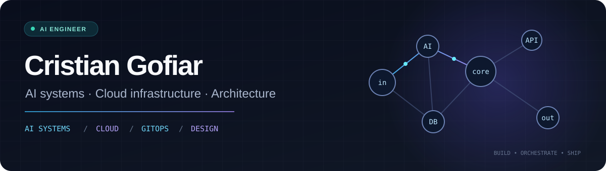

### About

I'm a **Systems Engineer working in AI engineering**, based in Spain. I build and integrate AI-powered software, with an emphasis on **system architecture, cloud infrastructure, and production operations**.

My work spans **agentic workflows, retrieval systems, decision-oriented AI components, observability, and cloud-native delivery**. I care about maintainable designs, reliable behavior, and the trade-offs between quality, latency, and cost.

### Tech stack

**AI engineering & observability**

`LangGraph` · `LangChain` · `Langfuse` · `LLM APIs` · `Decision Models` · `RAG` · `Evaluation`

**Cloud & infrastructure**

`Infrastructure as Code` · `GitOps` · `CI/CD` · `Cloud-native systems`

**Backend, data & search**

`APIs` · `SQL` · `Pinecone` · `Vector Search` · `Distributed Services`

### Areas of work

| Area | Engineering focus |
| :--- | :--- |
| **AI systems** | Tool-using agents, orchestration, retrieval pipelines, decision models and model integration. |
| **Architecture** | Design patterns, component boundaries, maintainability and system evolution. |
| **Cloud & platform** | Cloud services, Kubernetes, Terraform, GitOps and delivery workflows. |
| **Observability** | Tracing, evaluation, diagnostics, performance, latency and cost. |
| **Data & search** | PostgreSQL, MongoDB, Elasticsearch, vector search and retrieval quality. |

### GitHub activity

<picture>
  <source media="(prefers-color-scheme: dark)" srcset="https://raw.githubusercontent.com/cristiangofiar/cristiangofiar/output/github-snake-dark.svg" />
  <source media="(prefers-color-scheme: light)" srcset="https://raw.githubusercontent.com/cristiangofiar/cristiangofiar/output/github-snake.svg" />
  
</picture>

